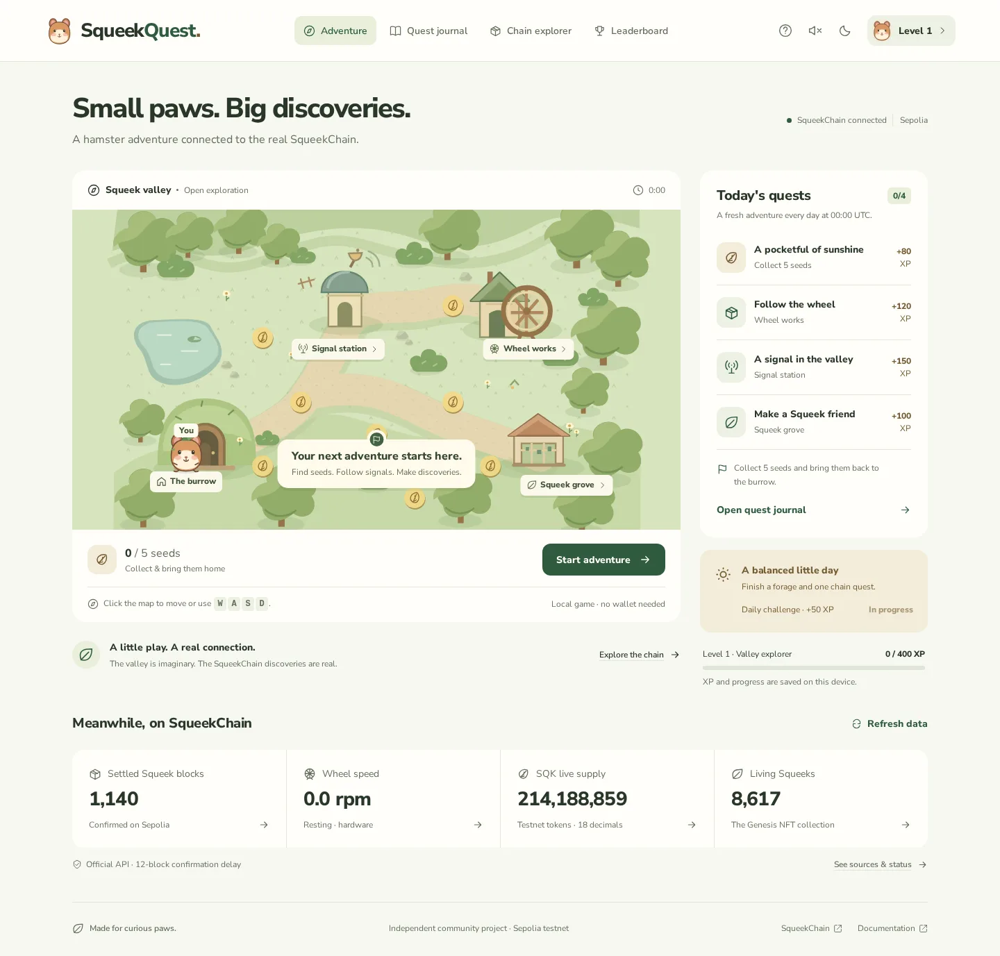

# SqueekQuest

A playable hamster adventure connected to real SqueekChain Sepolia data. Explore an original illustrated valley, collect sunflower seeds, and discover real settlements, events and Genesis Squeeks at three stations.

The submission includes complete Next.js, TypeScript and Tailwind source, a lockfile, and the ready-to-serve static website in **`dist/`**. No server, private key, wallet, project ID, or account is required to play.



## Play

1. Select **Start adventure**. Click the map or a seed to walk there. Arrow keys, WASD and mobile direction buttons also work.
2. Collect at least five seeds and return to **The burrow** to save a run and earn 80 daily game XP.
3. Visit **Wheel works**, **Signal station**, and **Squeek grove**. Inspect a real API record and select **Log discovery** to finish each chain quest.
4. Finish a forage and a chain quest to unlock the daily challenge. Claim its 50 XP in the adventure sidebar.

Every 400 XP adds a level. Quests reset at 00:00 UTC. There are five achievements, a discovery log, and a leaderboard of your own completed foraging runs. You can pause, replay, rename your explorer, switch themes, enable optional sound, and export progress as JSON.

**Seeds and XP are local game points with no monetary value.** The game never issues SQK, NFTs or transactions. The leaderboard and progress live in this browser, not in a shared backend or on-chain. Browser data can be edited or cleared; rankings are not competitive or tamper-proof. The most recent 50 runs and 1,000 discovery receipts are retained, with lifetime XP and unlocked achievements preserved.

## Install, preview, rebuild

Use Node.js 22 or 24 and npm. Dependencies are locked; no environment file is needed.

```sh
npm ci
npm run preview
```

Open **http://localhost:4173/preview/**. Preview serves the included production export under a subpath. An ordinary static web server can also serve the contents of `dist/` directly.

```sh
npm run dev        # Next.js development server
npm run build      # Next static export -> out/ -> dist/
npm run typecheck
npm test
npm run check:export
```

`next.config.mjs` uses `output: 'export'` and relative chunk URLs. `scripts/export.mjs` copies the generated export into `dist/` and normalizes document-owned URLs. Navigation uses URL hashes, so static hosting needs no route rewrites. Fonts, illustrations, favicon, and share image are bundled locally. API data is fetched in the browser at runtime; builds do not need a working API.

Publish the **contents of `dist/`** to a static host, IPFS gateway subpath, or GitHub Pages. The contributor network receives this committed export for its publication pipeline. No public GitHub repository URL or public website URL was created during this workspace run; do not mistake the local preview address for a deployment. Public URL assignment is a publication handoff after this delivery.

## Real SqueekChain integration

All reads use `https://api.squeekchain.com/v1`. The supported network is **Ethereum Sepolia, chain ID 11155111**. The documented deployment is release `core-sepolia-20261103`, revision 7. The app is read-only and has no transaction flow.

| Integration | Endpoint | Used for |
| --- | --- | --- |
| Network and wheel status | `/status` | Device freshness, wheel speed, daily distance, oracle status |
| Settled SqueekCore state | `/core` | Settled height, work, round and block progress |
| Provisional Squeek blocks | `/measurement/blocks` | Optimistic frontier count, separately labeled |
| Blockchain events | `/events?limit=20` and cursor pagination | Searchable event explorer and Signal station quest |
| Hamster measurement statistics | `/measurement/stats?range=7d` | Daily activity chart with explicit missing coverage |
| SQK economy | `/economy/state` | Supply, mining issuance, staking, burns and collection totals |
| Settlement history | `/settlements?range=24h` | Block range explorer and Wheel works quest |
| Squeek NFT | `/squeeks/{tokenId}` | Validated ID lookup, owner, power, traits and on-chain artwork |

Schemas validate the fields the app consumes, response versions, installation, chain, supported deployment pins and record provenance. Safe events must come from supported contracts at or below the safe frontier; settlement ranges must be internally consistent. API-provided confirmations are checked. This is validation of the official API's claims, not independent RPC verification or a cryptographic proof.

See [integration details](artifacts/INTEGRATIONS.md) for addresses, quest evidence and failure behavior. The official [API documentation](https://docs.squeekchain.com/developers/api/) and [deployment documentation](https://docs.squeekchain.com/developers/) describe the upstream data.

### Availability and trust

- Polls every 30 seconds while the page is visible; statistics refresh every 2 minutes. Conditional ETags and local minimum cache intervals avoid needless reads.
- Requests time out after 12 seconds. HTTP 429/503 responses respect `Retry-After`; the UI offers retry. There is no automatic rapid retry loop.
- Unavailable, malformed, unsupported-network and unsupported-release responses cannot create quest rewards. Stale readings remain labeled, and chain claims require a recent successful read.
- Provisional measurements never complete a blockchain quest. Real records include transaction links and safe block information.
- Missing data is **unavailable**, not zero. Foraging remains playable during an outage. No fixture, generated number, invented player, or simulated chain event is used as a runtime fallback.

## Validation

Actual recorded results are in [artifacts/validation.md](artifacts/validation.md). The worker ran the production build, standalone TypeScript check, meaningful unit and browser tests, live API reads, the pinned design probe, and an automated accessibility review. Reports are worker observations, not an independent certification.

To repeat browser checks on a machine with Playwright browsers installed:

```sh
npx playwright install chromium
npm run test:browser
npm run test:a11y
npm run test:api
# Optional second engine:
npx playwright install webkit
npm run test:browser -- --webkit
```

The browser scripts manage and close their own local static preview. They support the standard `HTTPS_PROXY` setting for test networks and an optional `SQUEEKQUEST_CHROMIUM` executable path; neither setting is bundled into the website. WebKit could not launch on the worker because system libraries were missing. Physical mobile devices, actual screen readers and browser-native zoom remain unverified.

## Screenshots and design

- [Mobile first screen](artifacts/screenshots/chromium-adventure-mobile.webp)
- [Foraging in progress](artifacts/screenshots/chromium-foraging.webp)
- [Real event explorer](artifacts/screenshots/chromium-explorer.webp)
- [Real Squeek NFT discovery](artifacts/screenshots/chromium-squeek-discovery.webp)
- [Dark theme](artifacts/screenshots/chromium-dark.webp)
- [API outage recovery](artifacts/screenshots/chromium-api-unavailable.webp)

[DESIGN.md](DESIGN.md) records the implemented tokens, typography, components and responsive behavior. [Attribution](artifacts/ATTRIBUTION.md) retains design-guide and font credits.

## Architecture and ecosystem contribution

`src/lib/api.ts` owns the public API boundary and BigInt formatting. `src/hooks/use-chain.ts` coordinates reads. `src/lib/game.ts` owns progression and persistence. The map, record views, native dialog, and icons are separate components; `src/pages/index.tsx` composes the four application views. Tests use captured real responses only as offline validation fixtures.

SqueekQuest gives community members a low-friction way to understand the wheel-to-chain pipeline. Each quest turns a real record into an explorable discovery with its source intact. The dashboard explains confirmed work, provisional work, missing measurements and protocol issuance without implying a token payout. The small static export can be mirrored by community hosts, and the reusable API boundary offers another reference for building read-only ecosystem tools.

## Submission size

Source, lockfile, runtime assets, `dist/`, documentation, screenshots and reports are included. Generated dependencies, caches, build internals, browser engines and scratch files are excluded at every nesting level. No submodule or dependency archive is included. The explicit `.gitignore` budget is **1,024 bytes**; it covers only generated/cache paths and scratch files and never excludes `dist/`. The complete allowed-file size is recorded in `artifacts/submission-budget.json` and must remain below **8,388,608 bytes**.

Application code and original illustrations: MIT. Font and third-party notices retain their own licenses.
