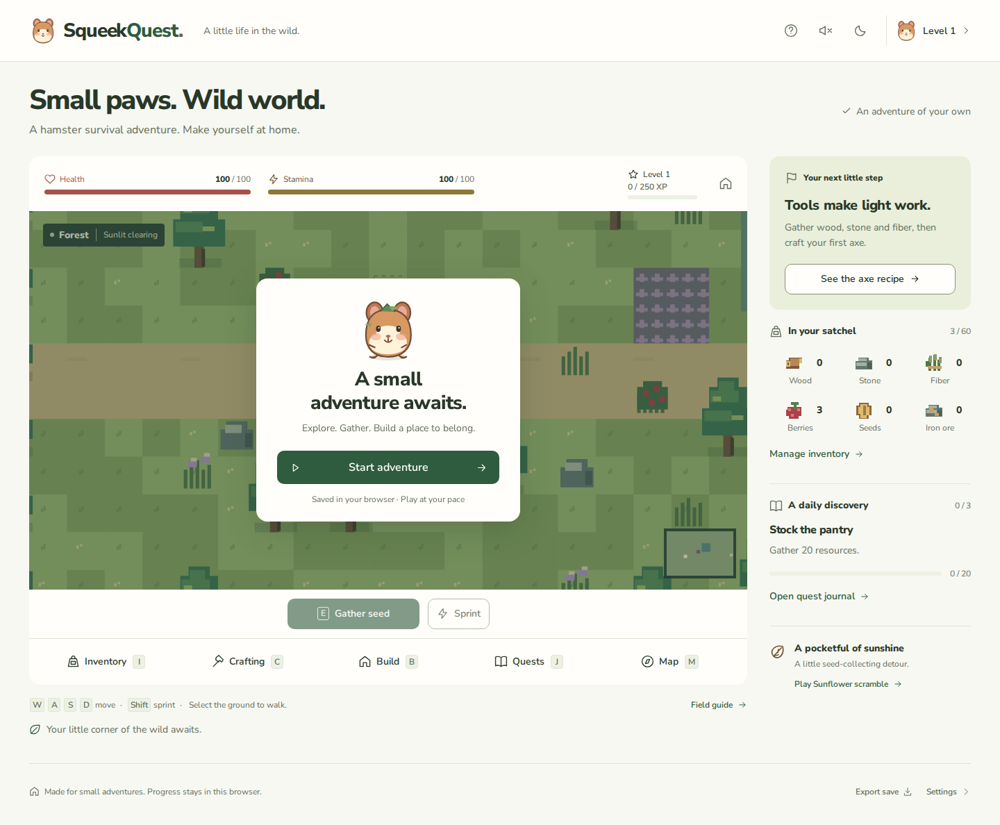

# SqueekQuest

A 2D hamster survival adventure for desktop web. Explore a forest, an abandoned village and the wilderness; gather supplies, craft tools, and turn a burrow clearing into a home. Progress lives in this browser. The complete static site is included in **`dist/`**.

This continues the existing Next.js/React/TypeScript project. The original hamster art, valley, fonts, dialogs, themes, sound and seed-foraging game remain. Existing version 1 profiles migrate their name, XP, achievements and foraging records. The playable site now works entirely locally: it makes no blockchain or API requests and needs no account, server or paid service. The earlier API modules and captured test fixtures remain as dormant historical source; they are not loaded by the adventure.



## Play

Select **Start adventure**, or **Continue adventure** to resume a saved game.

- Move with **WASD / arrow keys**, or select the ground to walk. Paths go around trees, water and ruined walls. Hold **Shift**, or toggle **Sprint**, to move faster at a stamina cost.
- Select a resource to walk over and gather, or stand beside it and press **E**. Trees, stones and plants regrow after **75 seconds of active adventure time**. An axe doubles wood yield; a pickaxe doubles stone yield and lets you mine ore.
- Open **Inventory (I)** to inspect materials, eat berries or trail mix, use a bandage, or drop one item. Stacks combine automatically. Capacity starts at 60 items; tools do not occupy it.
- Open **Crafting (C)** for recipes and exact costs. Crafted tools equip automatically and do not break. The explorer pack requires the workbench in the burrow clearing.
- Open **Build (B)** in the forest burrow clearing. Structures have real costs, appear in the world, and have three levels. Rest in a shelter, heal near a campfire, expand inventory with a chest, or grow berries in a garden.
- Follow the forest path **east** to the village, then the village path **north** to the wilderness. Open **Map (M)** to start walking toward a trail marker; press **E at the marker** to cross. Each area has resources, a hazard and a hidden cache. Violet thorns hurt; mud slows movement; water and walls block it.
- Open **Quests (J)** to claim daily rewards, see progress and view seven achievements. Quests reset at 00:00 UTC. Every 250 XP adds a level. Fainting returns you to the forest with your supplies and costs up to 20 XP.
- Play **Sunflower scramble**, the preserved foraging mini-game. Collect at least five seeds and return to its burrow. Records stay in your profile, seeds enter your inventory if space allows, and the daily quest awards 80 XP when claimed.

Direction buttons support narrow touch layouts. Desktop is the primary play target. **Escape** pauses the adventure. Panels and a hidden browser tab also pause world time, resource regeneration and garden growth.

| Structure | Level 1 | Level 2 | Level 3 |
| --- | --- | --- | --- |
| Burrow shelter | Rest restores health/stamina | +20 maximum stamina | Also +20 maximum health |
| Campfire | Heal 2 health/second nearby | Heal 4/second | Heal 6/second |
| Storage chest | +40 inventory capacity | +80 total capacity | +120 total capacity |
| Berry garden | 4 berries per harvest | 8 berries | 12 berries |

Gardens take 90 active seconds between harvests. Chests expand one shared satchel; building uses fixed sites in the burrow clearing. Health, stamina, resource counts, costs, timers, XP and unlocks come from actual local game state.

## Saves

Position, area, health, stamina, inventory, tools, buildings, resource cooldowns, hidden rewards, daily quests, XP, statistics, run records and preferences are saved under `squeekquest.survival.v2`. The app saves every five seconds, on pause/panel opening, on page hide, and after explicit inventory/crafting/building/quest actions. **Continue** restores the saved world; **New game** requires a separate confirmation before replacing it.

Use **Export save** for a JSON backup and **Settings → Import save** to restore a validated backup. Import replaces the current adventure, so export first to retain both. Invalid imports keep the current adventure. Invalid stored saves show recovery guidance rather than silently overwriting the original data. If storage is denied or full, play can continue for the visit and export remains available. Clearing browser data removes the local save. Nothing is shared between browsers or visitors; there is no global leaderboard.

## Install, preview and rebuild

Use Node.js 22 or 24 and npm. Existing dependencies and the lockfile are unchanged. No environment file is needed.

```sh
npm ci
npm run preview
```

Open **http://localhost:4173/preview/** to play the included export. To preview without installing packages, run `node scripts/preview.mjs` directly. The preview deliberately uses a subpath to exercise relative assets. Any ordinary static web server can serve `dist/`.

```sh
npm run dev          # development server
npm run typecheck    # standalone TypeScript check
npm test            # survival, legacy game and offline API validator tests
npm run build       # Next static export -> out/ -> dist/
npm run check:export # relative asset, metadata and export-size checks
```

`next.config.mjs` retains `output: 'export'` and `assetPrefix: '.'`. The existing `scripts/export.mjs` rebuilds `dist/` and converts document-owned asset URLs to relative paths. The app uses one page and local dialogs; static hosts need no server routes or rewrites. All fonts, pixel sprites, illustrations, favicon and share image are local. Deliver the **contents of `dist/`** to the static host; no publishing command is needed in this workspace.

## Validation

Run browser validation after building:

```sh
npx playwright install chromium
npm run test:browser
npm run test:a11y
node scripts/check-quality.mjs # focus, text enlargement, rendered contrast
node scripts/check-budget.mjs  # complete deliverable bytes
# Optional, on a host with WebKit system libraries:
npx playwright install webkit
npm run test:browser -- --webkit
```

Browser scripts manage and close a local preview. They inspect the production export, including its `/preview/` asset paths, real controls, save failures and resource loading. Controlled saves used by the tests are never shipped as runtime fallback content. `SQUEEKQUEST_CHROMIUM` may select a local Chromium executable for the test runner; it is not used by the app.

The worker ran the production build, standalone typecheck, 24 unit tests, the Chromium walkthrough, accessibility checks and the pinned 16-check design probe. Full commands, final results, findings and explicit limitations are in [artifacts/validation.md](artifacts/validation.md). WebKit could not launch because its required system libraries are missing. Physical devices, native browser zoom and actual screen-reader sessions remain untested. These are worker observations, not independent certification.

## Source and design

- `src/lib/survival.ts`: world layouts, collision/pathfinding, inventory, resource costs, crafting, structures, survival, daily quests, achievements and validated saves/migration.
- `src/components/survival-map.tsx`: pixel renderer, camera, frame-based movement, pointer/keyboard/touch controls and minimap.
- `src/pages/index.tsx`: menu, HUD, panels, local persistence and audio.
- `src/components/game-map.tsx` and `src/lib/game.ts`: original seed-foraging mini-game and legacy save support.
- `src/styles/survival.css`: survival UI, built on the existing tokens and shared styles in `globals.css`.
- `tests/survival.test.ts`: meaningful state, economy, movement and persistence checks. Existing tests remain.

[DESIGN.md](DESIGN.md) describes the implemented design system. [Attribution](artifacts/ATTRIBUTION.md) retains licenses for the existing art, local font and pinned guidance. The original package description and optional API-check command remain historical because the assignment protects the dependency manifests; the current playable site has no live integration.

No requested gameplay system is represented by a placeholder. The scope is a small local adventure with fixed building sites, regenerating resources and environmental hazards. Save integrity checks are for recovery, not anti-cheat. The latest 50 foraging records are retained; the profile displays the fastest ten.

## Submission budget

Source, the existing manifest/lockfile, complete `dist/`, runtime assets, documentation and validation screenshots are included. Generated dependencies, browser downloads, caches, build internals and disposable `test/scratch/` files are excluded by the existing ignore rules. The ignore file was not changed (its existing path budget is 1,024 bytes). No dependency archives, registry mirrors or submodules are added. The final byte count is recorded in [artifacts/submission-budget.json](artifacts/submission-budget.json) against the **8,388,608-byte** limit.
